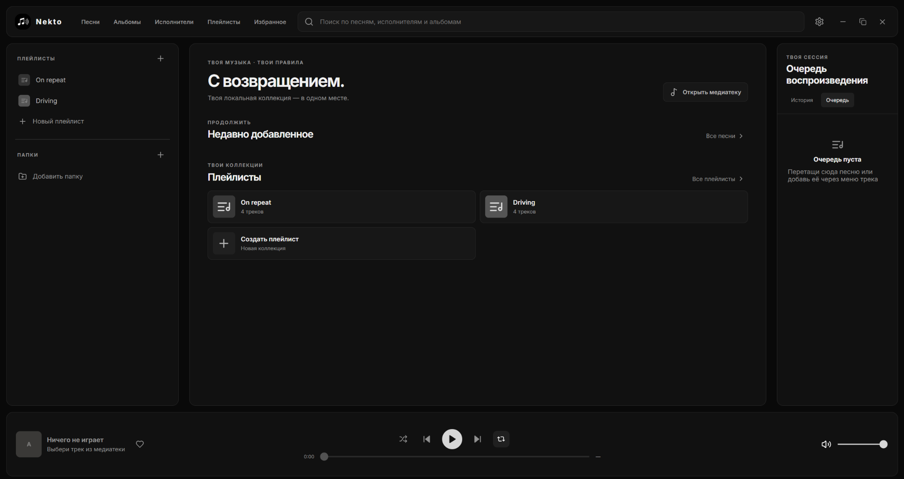
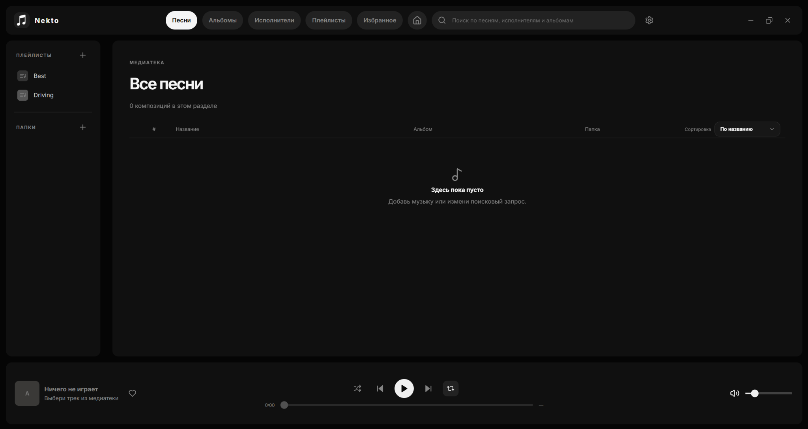

<!--
  Nekto 1.1 — README
  Screenshots are stored in /screenshots.
-->

<div align="center">
  

  <h1>Nekto 1.1</h1>
  <p><strong>Твоя музыка. Твои правила.</strong></p>
  <p>Локальный музыкальный плеер для Windows — медиатека, плейлисты и управление воспроизведением в одном приложении.</p>

  <p>
    <a href="https://github.com/nekto503/Nekto/releases/latest"></a>
    <a href="https://github.com/nekto503/Nekto/issues"></a>
  </p>
  <p>
    
    
    
    
  </p>
</div>

---

## Интерфейс

<div align="center">
  <h3>Главная страница</h3>
  
</div>

<table>
  <tr>
    <td align="center" width="50%"><strong>Медиатека</strong></td>
    <td align="center" width="50%"><strong>Плейлисты</strong></td>
  </tr>
  <tr>
    <td width="50%"></td>
    <td width="50%"></td>
  </tr>
</table>

## Возможности

### Музыкальная библиотека
- Локальная медиатека с подключением нескольких музыкальных папок.
- Чтение ID3-метаданных и отображение встроенных обложек.
- Автоматическое обновление библиотеки при изменениях в папках: файловый watcher и резервное сканирование.
- Импорт MP3 и папок перетаскиванием из Проводника.
- Поиск и сортировка песен, просмотр альбомов и исполнителей.

### Воспроизведение
- Воспроизведение локальных аудиофайлов, перемотка и регулировка громкости.
- Переключение треков, перемешивание и повтор.
- Очередь воспроизведения с изменением порядка, удалением отдельных треков и очисткой.
- История прослушивания и избранное.

### Плейлисты
- Создание, переименование и удаление плейлистов.
- Описание и пользовательская обложка плейлиста.
- Добавление песен перетаскиванием или через меню.
- Изменение порядка треков внутри плейлиста.
- Защита от добавления дубликатов.
- Запуск плейлиста и добавление всего плейлиста в очередь.
- Сохранение плейлистов, описаний и очереди между запусками.

### Настройка интерфейса
- Семь тем оформления: Graphite, Paper, Warm, Ash, Pearl, Glass и Studio.
- Настраиваемая правая панель: вкладки можно скрывать и менять местами.
- Изменение ширины боковых панелей перетаскиванием; двойной щелчок возвращает стандартную ширину.
- Компактная и комфортная плотность интерфейса.
- Масштабирование сочетанием Ctrl + колесо мыши, горячие клавиши и настройки поведения.

### Тексты песен
Nekto поддерживает локальные файлы синхронизированных текстов `.lrc`.

Положи рядом с аудиофайлом одноимённый файл:
```text
Track.mp3
Track.lrc
```

Поддерживаются кодировки UTF-8 и Windows-1251.

## Скачать и установить

1. Открой страницу [последнего релиза Nekto](https://github.com/nekto503/Nekto/releases/latest).
2. Скачай Windows-установщик **EXE** из раздела **Assets**.
3. Запусти установщик и следуй инструкциям.
4. Открой Nekto через меню «Пуск» или ярлык на рабочем столе.
5. Добавь папку с музыкой — приложение соберёт локальную медиатеку.

> Для обычной установки используй EXE из релиза. Исходный код репозитория предназначен для разработчиков.

## Технологии

| Часть | Технологии |
|---|---|
| Desktop | [Tauri 2](https://tauri.app/) |
| Интерфейс | [React](https://react.dev/), [TypeScript](https://www.typescriptlang.org/) |
| Сборка frontend | [Vite](https://vite.dev/) |
| Backend | Rust |
| Хранение данных | SQLite |

## Разработка

### Требования

- Windows 10/11 x64.
- Node.js LTS (рекомендуется 22.x) и npm.
- Rust stable, установленный через [rustup](https://rustup.rs/).
- Visual Studio 2022 Build Tools с workload **Desktop development with C++** и Windows SDK.
- WebView2 Runtime (обычно уже установлен в Windows 10/11).

### Установка зависимостей

Открой PowerShell в корне проекта — в папке, где находятся `package.json`, `app` и `src-tauri`:

```powershell
npm --prefix app install
```

### Запуск в режиме разработки

```powershell
app\node_modules\.bin\tauri.cmd dev
```

### Проверка frontend

```powershell
npm --prefix app run build
```

### Проверка Rust

```powershell
cargo check --manifest-path src-tauri/Cargo.toml
```

### Сборка Windows-установщика

В PowerShell из корня проекта:

```powershell
Set-ExecutionPolicy -Scope Process Bypass
.\scripts\build-windows.ps1
```

Скрипт устанавливает npm-зависимости, собирает frontend, выполняет `cargo check`, собирает NSIS-установщик и проверяет, что создан новый EXE.

Готовый установщик должен находиться в:

```text
src-tauri\target\release\bundle\nsis\
```

Успешная проверка синтаксиса в другой среде не заменяет полноценную сборку на Windows.

## Данные и конфиденциальность

- Музыкальная библиотека и пользовательское состояние хранятся локально.
- Аудиофайлы не загружаются в облако.
- Состояние плейлистов, очереди и интерфейса сохраняется между запусками.

## Обратная связь

Нашёл ошибку, хочешь предложить улучшение или задать вопрос? [Создай Issue в репозитории](https://github.com/nekto503/Nekto/issues).

---

<div align="center">
  <sub><strong>Nekto 1.1</strong></sub><br />
  <sub>Твоя музыка. Твои правила.</sub>
</div>
