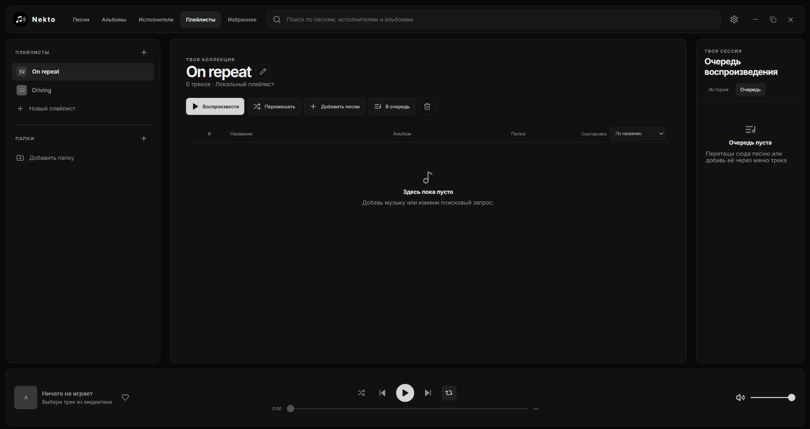

  
  <h1>Nekto</h1>
  
<strong>Твоя музыка. Твоя библиотека. Твой интерфейс.</strong>

  
Локальный музыкальный плеер для Windows — без лишнего шума вокруг твоей музыки.

  

    
    
    
  

  
<a href="https://github.com/nekto503/Nekto/releases/latest">Скачать Nekto</a> · <a href="https://github.com/nekto503/Nekto/issues">Сообщить об ошибке</a>

---

## Интерфейс

<strong>Главная — твоя музыкальная коллекция в одном месте</strong>

<table>
  <tr>
    <td width="50%" align="center"><strong>Медиатека</strong></td>
    <td width="50%" align="center"><strong>Плейлисты</strong></td>
  </tr>
  <tr>
    <td width="50%"></td>
    <td width="50%"></td>
  </tr>
</table>

## Что умеет Nekto

- **Единая локальная медиатека** — подключай музыкальные папки и собирай композиции в одном месте.
- **Автоматическое обновление** — приложение отслеживает изменения в подключённых папках.
- **Музыкальная навигация** — песни, альбомы, исполнители, плейлисты и избранное.
- **Плейлисты** — создавай собственные подборки и управляй их содержимым.
- **Очередь и история** — добавляй треки в очередь, меняй порядок и возвращайся к прослушанному.
- **Управление воспроизведением** — перемотка, громкость, следующий/предыдущий трек, перемешивание и повтор.
- **Настраиваемый интерфейс** — темы, панели и их ширина, плотность отображения.
- **Локальная работа** — музыкальная коллекция остаётся на твоём компьютере.

## Установка

1. Открой [последний релиз Nekto](https://github.com/nekto503/Nekto/releases/latest).
2. Скачай `Nekto-1.0.0-Setup.exe` из раздела **Assets**.
3. Запусти установщик и следуй инструкциям.
4. Открой Nekto через меню «Пуск» или ярлык Windows.
5. Добавь папку с музыкой — Nekto просканирует её и соберёт медиатеку.

> ZIP с исходным кодом предназначен для разработчиков. Для обычной установки нужен EXE-файл.

## Скачать

| Файл | Для кого | Ссылка |
|---|---|---|
| `Nekto-1.0.0-Setup.exe` | Пользователям Windows | [Скачать установщик](https://github.com/nekto503/Nekto/releases/latest/download/Nekto-1.0.0-Setup.exe) |
| `Nekto-1.0.0-hotfix-15.zip` | Разработчикам | [Скачать исходный проект](https://github.com/nekto503/Nekto/releases/latest/download/Nekto-1.0.0-hotfix-15.zip) |

## Технологии

- [Tauri 2](https://tauri.app/) · [React](https://react.dev/) · [TypeScript](https://www.typescriptlang.org/)
- [Vite](https://vite.dev/) · Rust · SQLite

## Обратная связь

Нашёл проблему или есть идея? [Создай Issue](https://github.com/nekto503/Nekto/issues).

---

  Nekto 1.0.0 · Hotfix 15 
  Твоя музыка. Твои правила.

